# 枝理 ZhiLi

枝理是一款离线桌面思维导图工具。它从银河麒麟等桌面系统的日常需求出发，把记录思路、整理分支、批量修改和交付图稿集中在一张画布上。导图保存在本机，同一个开放的 `.smap` 文件可以在不同平台继续编辑。

[下载最新版](https://github.com/bhuyuqingguo/ZhiLi/releases/latest) · [v1.0.3 发布说明](docs/releases/v1.0.3.md) · [格式兼容清单](docs/FORMAT_COMPATIBILITY.md) · [反馈问题](https://github.com/bhuyuqingguo/ZhiLi/issues)

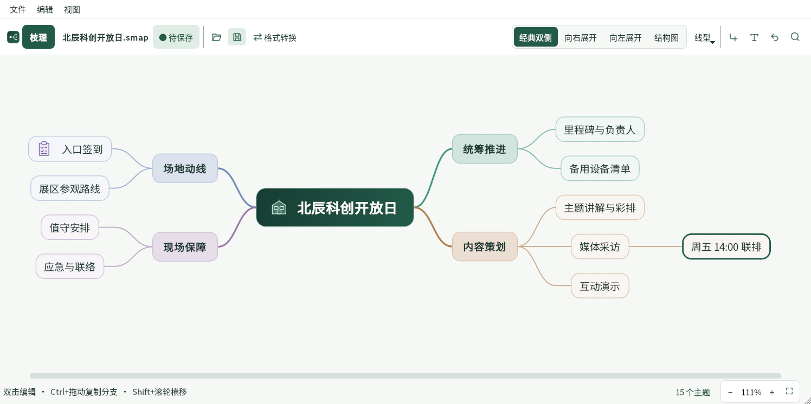

## 下载与启动

| 平台 | 下载与启动 |
| --- | --- |
| Windows 10 / 11 x64 | 下载 `ZhiLi-v1.0.3-Windows-x64.zip`，解压后运行 `ZhiLi/simplemap.exe`，保留同目录的 DLL 和 `platforms` 文件夹。 |
| Linux ARM64 | 下载 `ZhiLi-v1.0.3-Linux-ARM64-Portable.tar.gz`，解压后运行 `ZhiLi/ZhiLi`。需要 glibc 2.31 或兼容版本，以及系统 Qt5 Core、Gui、Widgets、Svg 和桌面平台插件。 |
| macOS | 可用 Qt5 从源码构建 `simplemap.app`，应用包包含枝理图标。当前 GitHub Release 提供 Windows x64 和 Linux ARM64 便携包。 |

完整包和对应 SHA-256 校验文件均带发布版本号。Windows 程序未做代码签名。Linux 可运行 `uname -m` 确认架构为 `aarch64`，用 `sha256sum -c ZhiLi-v1.0.3-Linux-ARM64-Portable.tar.gz.sha256` 校验下载。银河麒麟 V10 SP1／飞腾 D2000 的输入法、混合 DPI 和真机行为仍需现场验收。 [目标平台验收清单](docs/TARGET_ACCEPTANCE.md)

已有原版 `v1.0.2` 便携包，可下载同平台的 `v1.0.2-to-v1.0.3` 增量包、对应校验文件和 `ZhiLi-v1.0.3-update.py`。更新工具校验基线并在新目录重建新版，旧目录可留作回退。 [离线增量升级说明](docs/INCREMENTAL_UPDATE.md)

## 用一张图上手

解压后打开 `examples/研发项目交付.smap`，也可以从空白或模板开始。工具栏常驻打开、保存、格式转换和布局切换。窄窗口下，常用操作会收进紧凑工具栏。

| 要做什么 | 怎么操作 |
| --- | --- |
| 录入想法 | 双击或按 **F2** 编辑。**Enter** 加同级，**Tab** 或 **Insert** 加子主题。编辑时 **Enter** 确认、**Shift+Enter** 换行。 |
| 框选和整理分支 | 点击画布右下角的框选按钮，再从空白处拖动，也可直接按 **Shift** 拖动空白处。**Ctrl+单击** 可逐项增减，从任一选中项拖动整组。 |
| 聚焦或查找 | **Ctrl+Shift+J** 同时打开全图概览与分支编辑区，单击全图中的主题切换分支，**Esc** 返回原全图视图。**Ctrl+F** 查找，**F3** 跳到下一个结果。 |
| 缩放和平移 | **Ctrl+滚轮** 缩放，**Ctrl+0** 适应窗口，拖动画布空白处平移。 |
| 批量统一样式 | 多选后按 **Ctrl+Shift+F**，勾选需要修改的对齐、字体、字号、字重或颜色。 |
| 保存与分享 | **Ctrl+S** 保存。右键可复制当前分支为透明图片，或只导出该分支。 |

窗口底部会根据编辑、框选、拖动、多选或聚焦状态给出快捷键提示。**F1** 打开离线帮助和快捷键速查，「帮助 → 关于枝理」显示应用版本和运行环境。

## 界面实拍

以下为 Windows 界面实拍。同一张示例图可以直接切换四种布局。连线可选自动搭配、直角、直线和曲线。

| 经典双侧 | 向右展开 |
| --- | --- |
| 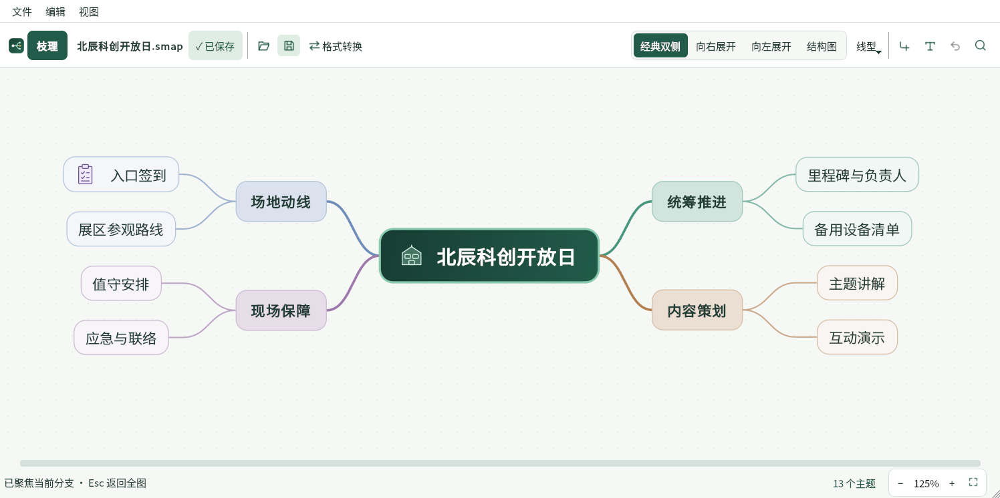 | 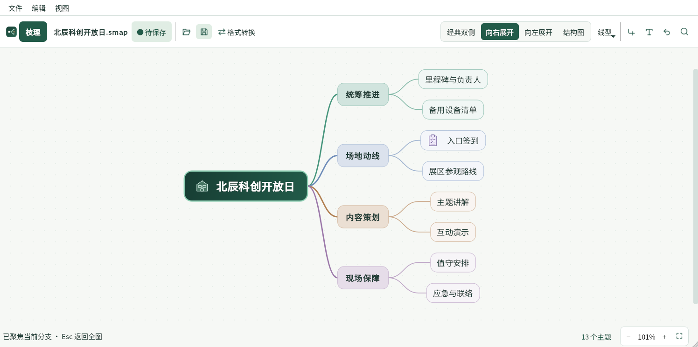 |
| **向左展开** | **纵向结构图** |
| 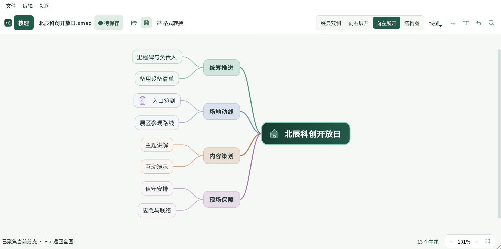 | 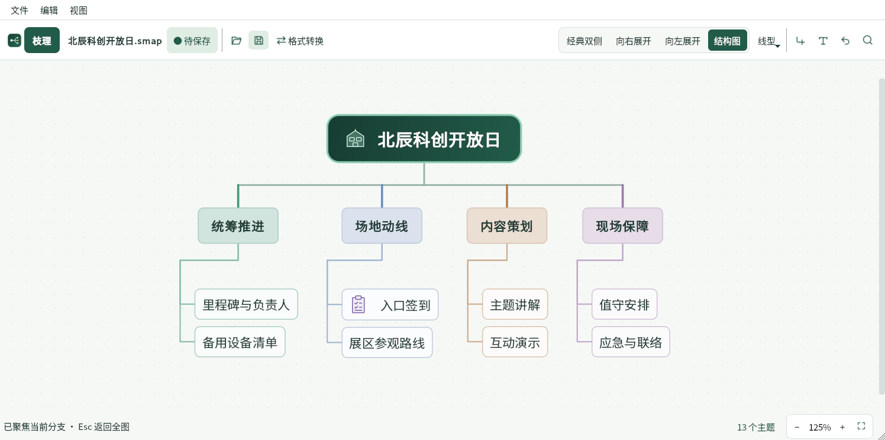 |

### 拖拽、聚焦与窄窗口

整组拖动时，外框和插入线标出落点。松手后自动重排主题与连线，一次撤销即可恢复整组。聚焦后全图概览与分支编辑区同时显示，修改主题后概览同步刷新。分隔线可拖动，窄窗口改用上下排列。

| 整组拖动与吸附 | 聚焦当前分支 |
| --- | --- |
| 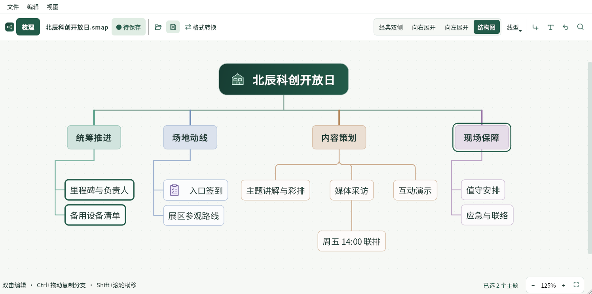 | 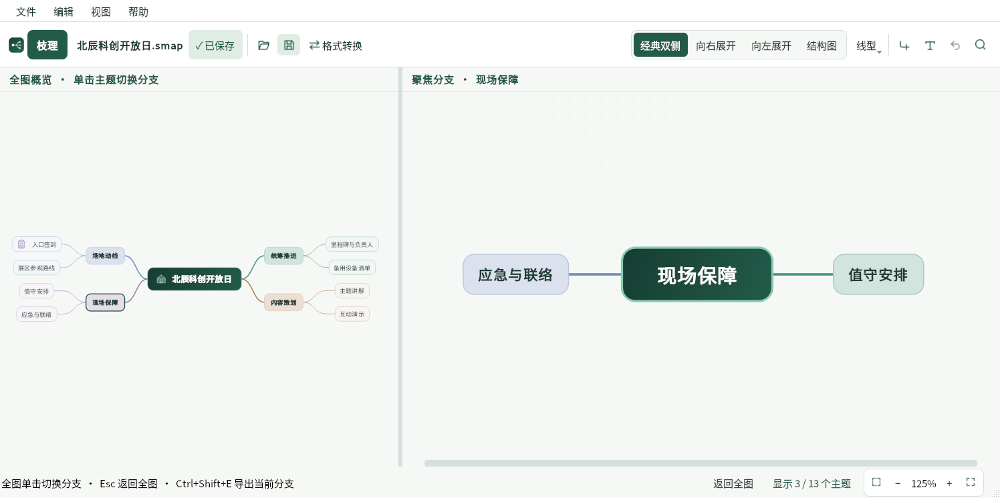 |

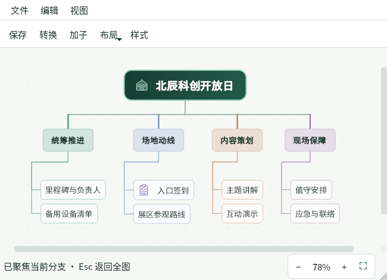

### 中文排版

节点文字默认居中。批量样式只应用勾选的项目，也可以从一个主题复制样式，再粘贴给其他主题。枝理内置思源黑体、思源宋体、霞鹜文楷 GB 轻便版和得意黑，系统字体列表优先显示中文字体。 [字体及许可](assets/fonts/README.md)

| 批量主题样式 | 中文字体优先 |
| --- | --- |
| 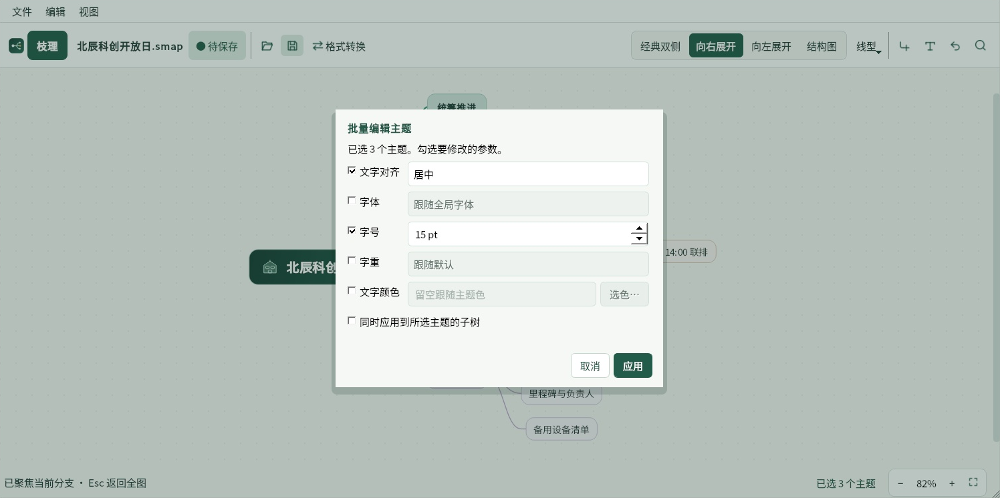 | 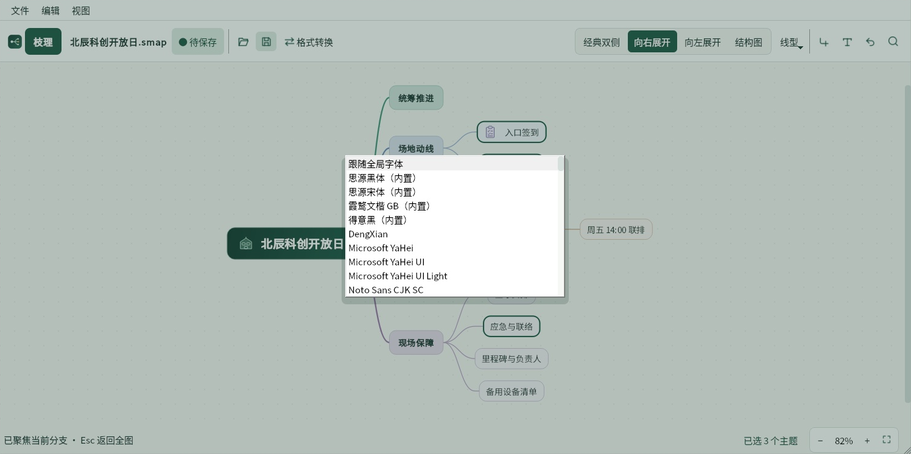 |

### 离线转换

点击「格式转换」，直接选取原文件，再选目标格式和保存位置。要先检查结果，可用「文件 → 导入其他导图」打开为可编辑副本。

| 选择原文件 | 转为开放的枝理导图 |
| --- | --- |
| 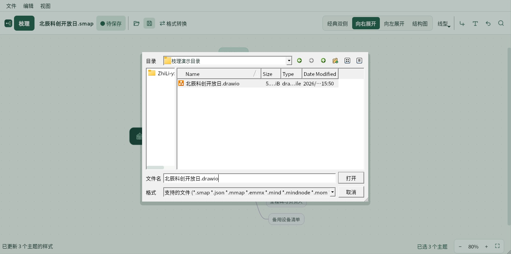 | 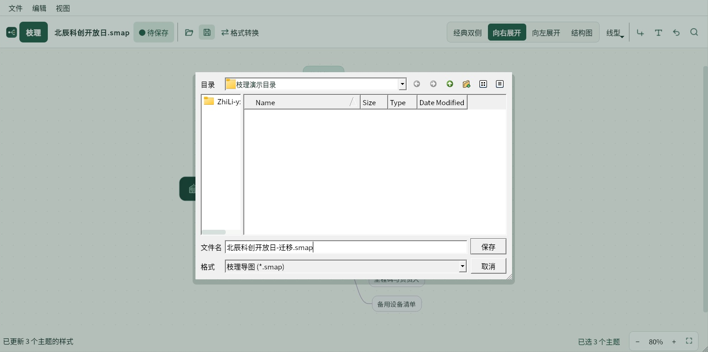 |

## 导入、转换与交付

- **读入导图**支持 Xmind、MindManager、MindMaster / EdrawMind、MindNode、MindMeister、Mindomo、FreeMind / Freeplane、OPML 等。MindMaster 的二进制 `.emmx` 以已验证的 10.7 和 10.9 文件为准。
- **读入图形和演示稿**支持 draw.io、Visio `.vsdx`、PowerPoint `.pptx`，也可读取 Markdown、缩进文本、Mermaid mindmap 和 JSON Canvas。
- **转换输出**支持枝理、draw.io、Visio、可编辑 PowerPoint、FreeMind、OPML、JSON Canvas、纯文本及 PNG、SVG、PDF。跨软件转换以文字、层级、顺序和可映射的连接为主。专有样式、图片、附件、动画和原坐标的保留范围见兼容清单。
- **导出当前分支**可生成透明 PNG、SVG、PDF、可编辑 PowerPoint 或独立 `.smap`。用「复制当前分支为图片」可直接粘贴到白板或演示稿。
- **开放文件**使用版本化 UTF-8 JSON，布局和节点样式随文件保存。异常退出后可在下次启动时恢复本地快照。 [格式兼容清单](docs/FORMAT_COMPATIBILITY.md) · [SMAP 文件规范](docs/SMAP_FORMAT.md)

枝理自带 80 个离线模板和 128 个透明矢量符号。可通过「文件 → 从模板新建」按用途搜索，从「视图 → 外观设置」切换简约 2D 和立体拟物风格。 [模板目录](assets/templates/README.md) · [符号目录](assets/symbols/README.md)

## 从源码构建

需要 C++11 编译器、CMake 3.13+、Qt 5.9+ 的 Widgets 和 Svg。运行自动化测试还需要 Qt Test。Windows 可用 `-DCMAKE_PREFIX_PATH` 指向与编译器和架构匹配的 Qt5 SDK。

```sh
cmake -S . -B build -DCMAKE_BUILD_TYPE=Release
cmake --build build --config Release
cd build
ctest -C Release --output-on-failure
```

反馈时请附应用版本、操作系统、CPU 架构、缩放比例、输入法和复现步骤。若附导图样例，请先移除敏感信息。 [发布构建说明](docs/RELEASE.md) · [提交 Issue](https://github.com/bhuyuqingguo/ZhiLi/issues)
